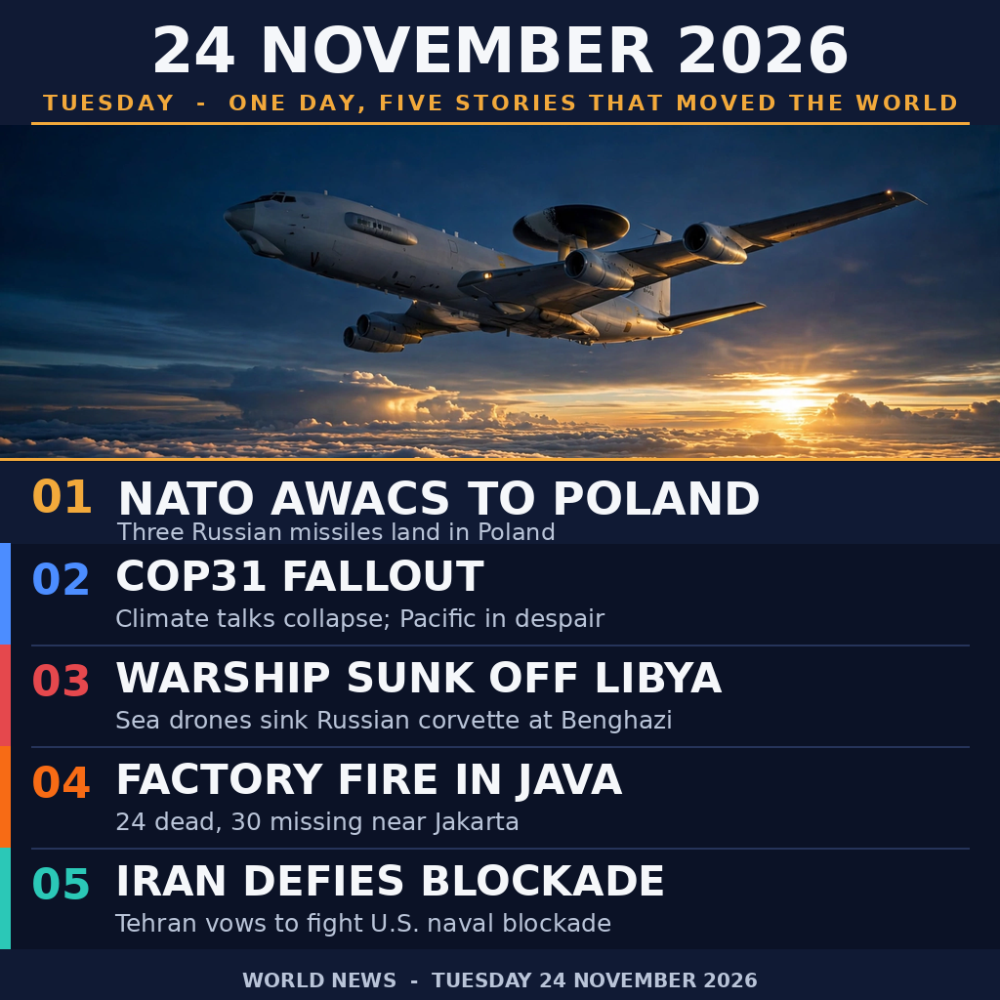

# One Day, Five Stories — Tuesday 24 November 2026

[](https://make.fun/bounty/news-image-20261124)
[](https://make.fun/bounty/news-image-20261124)
[](https://make.fun/bounty/news-image-20261124)

A single image that sums up the world's news of **Tuesday 24 November 2026** —
built for the make.fun competition
[news-image-20261124](https://make.fun/bounty/news-image-20261124)
("Sum up 24 November's world news in one image").



## The image

A dark "night desk" poster, not a newspaper page: one date shouted across the
top, one big picture, five stories in five numbered strips. Everything is set
in large type so the whole day still reads at 300 pixels across.

- **Masthead — 24 NOVEMBER 2026.** The date is the biggest thing on the page:
  this is one day, and the image says which one.
- **Hero — NATO AWACS to Poland.** An early-warning radar jet above a sea of
  golden clouds at dusk. Three Russian Kh-101 missiles landed in Poland on
  Friday; NATO answered by sending its AWACS early-warning aircraft to the
  alliance's eastern flank — the war edging toward NATO itself.
- **02 — COP31 fallout.** The climate talks collapsed in Antalya; the blame
  game began and Pacific nations spoke of despair.
- **03 — Warship sunk off Libya.** Sea drones sank the Russian corvette
  Merkury at Benghazi; the ship capsized and sank.
- **04 — Factory fire in Java.** A confectionery factory fire in Cikande,
  Banten: 24 dead, 30 missing.
- **05 — Iran defies blockade.** Tehran vowed to use all its tools against
  the U.S. naval blockade, as Washington sanctioned its shadow banking
  networks.

Five stories, five regions, five fields — an alliance on alert, a climate
summit in ruins, a war at sea, a disaster at home, a standoff in the Gulf.
Nothing invented, nothing hyped: every line is what was reported that day.

## Why this image wins

1. **It names its day.** 24 November 2026, in the largest type on the page.
2. **It reads at a glance.** One hero image, five short headlines, one line
   each — a viewer who missed the day can tell what happened from the image
   alone.
3. **It is faithful.** The numbers are the reported numbers (3 missiles, 24
   dead and 30 missing); the AWACS deployment is shown as the aircraft
   itself, not an invented scene of combat.
4. **It is clean.** Dark ground, amber accents, no smears, no garbled text —
   every word is set type, not rendered by a generator.

## How it was built

- The hero illustration (AWACS radar jet above golden clouds at dusk) was
  generated as a text-free image, then composed with the masthead, strips and
  footer in a Python/PIL layout script — all wording is crisp set type.
- `main.ts` (Node 22, standard library only) validates `entry.png` — PNG
  signature, IHDR size, colour type, IEND, at most 1024×1024 and 1 MiB —
  then copies it byte for byte to `$MAKEFUN_OUTPUT_DIR/entry.png` and
  verifies the copy by sha256. It runs twice and writes identical bytes.

## Run it

```sh
mkdir -p out && MAKEFUN_OUTPUT_DIR=out node main.ts
# writes out/entry.png, 1024x1024 PNG, 456,095 bytes
```

## License

MIT — see [LICENSE](LICENSE).
